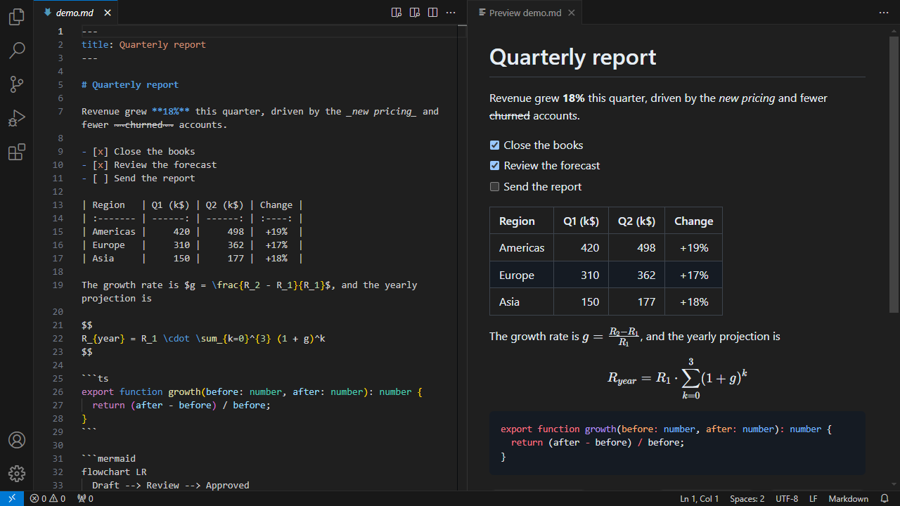
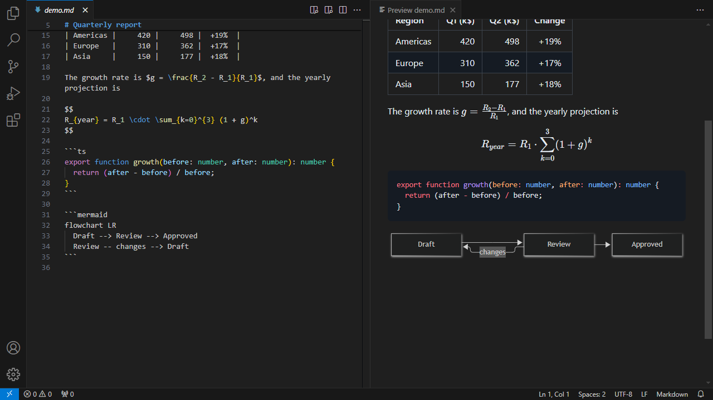
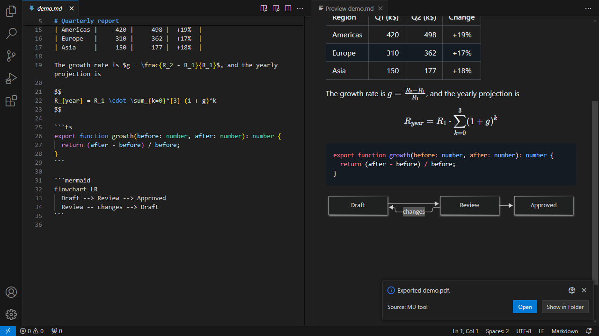
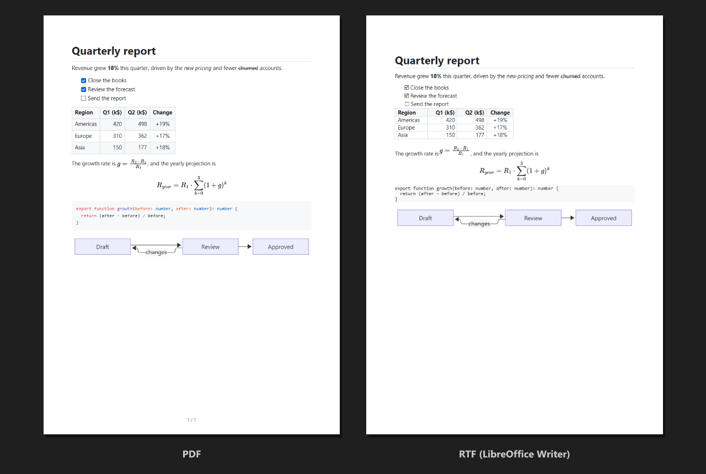
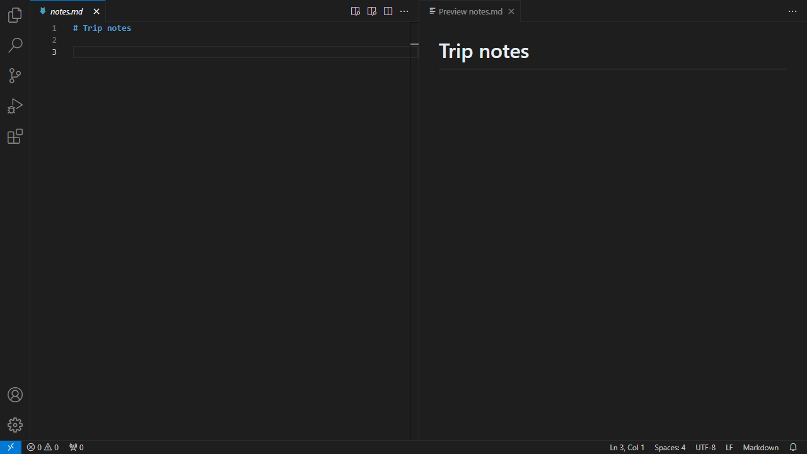

# MD tool

Visualize, edite e exporte Markdown para **PDF** e **RTF** sem sair do VS Code.

[Read in English](README.md)



## Funcionalidades

- **Preview ao vivo** no lugar do editor ou ao lado dele (`Ctrl+K Alt+V`), com rolagem
  sincronizada: os botões de livro e de painel lateral na barra do editor.
- Markdown no estilo GitHub: tabelas, listas de tarefas clicáveis, notas de rodapé, front matter.
- Realce de código, fórmulas **KaTeX** e diagramas **Mermaid**.
- Segue o tema do VS Code, ou fica sempre claro ou escuro; aceita CSS próprio por cima.
- **Exportar para PDF** e **RTF** (para Word e LibreOffice) sem instalar mais nada: sem
  navegador, sem Pandoc, sem LaTeX.
- PDFs com texto de verdade, links, marcadores e fórmulas e diagramas vetoriais.
- Um **visualizador de PDF e RTF** simples, para conferir o resultado sem sair do VS Code.
- Um **perfil ABNT** para documentos formais: seções numeradas, notas no pé da página, figuras
  e tabelas com identificação e fonte, paginação.
- **Atalhos de edição**: negrito, itálico, tachado e código (com vários cursores), links,
  formatação de tabelas, sumário e continuação de listas no Enter.



## Exportação

Use **Exportar para PDF** ou **Exportar para RTF** no menu de contexto do editor, no Explorer,
na barra do preview ou na Paleta de Comandos. O arquivo é gravado ao lado do Markdown (veja
`mdTool.export.outputDir`), e uma notificação oferece visualizar o arquivo, abri-lo no
programa padrão ou mostrá-lo na pasta.



O mesmo documento, exportado:



Os dois formatos são gerados pela própria extensão, com as fontes do sistema (embutidas no PDF):

- **PDF**: texto selecionável, links clicáveis (também para títulos e notas de rodapé), um
  marcador por título, número de página, e fórmulas, diagramas e imagens SVG como vetores.
- **RTF**: títulos com nível de estrutura, listas, tabelas, código e notas de rodapé; fórmulas,
  diagramas e imagens SVG/GIF/WebP entram como imagens PNG.

As fórmulas são diagramadas com o MathJax. Os diagramas Mermaid são desenhados pelo próprio
VS Code, num painel que abre ao lado do editor por um instante durante a exportação. Uma fórmula
ou um diagrama inválido sai como texto-fonte, com um aviso.

### Conferindo o resultado

**Visualizar**, na notificação da exportação, abre o arquivo num visualizador simples ao lado
do editor. Ele recarrega quando você exporta de novo, então pode ficar aberto enquanto você
trabalha no documento. Para abrir qualquer arquivo `.pdf` ou `.rtf` nele, use **Abrir no
Visualizador de PDF / RTF** no menu de contexto do Explorer ou **Reabrir Editor Com…**.

- **PDF**: páginas desenhadas pelo pdf.js, com texto selecionável, links funcionando e zoom.
- **RTF**: lido pela própria extensão: formatação do texto, títulos, listas, tabelas, links,
  notas de rodapé e imagens PNG/JPEG. Mostra o conteúdo, mas o Word e o LibreOffice podem
  diagramar um pouco diferente. Outros formatos de imagem (EMF, WMF) aparecem como `[image]`.

### Opções por documento

O front matter pode sobrescrever as opções do PDF:

```yaml
---
title: Relatório trimestral
pdf:
  format: Letter
  landscape: true
  margin: 15mm 20mm
  header: '{title}'
  footer: 'Página {page} de {pages}'
---
```

### Perfil ABNT

Para documentos formais segundo as regras da ABNT (NBR 14724, NBR 6024, NBR 10520), mude
`mdTool.export.profile` para `abnt`, ou escolha o perfil no próprio documento:

```yaml
---
perfil: abnt
subtitulo: Relatório anual
autor: Nome do Autor
local: Cidade
data: '2026'
---
```

O PDF e o RTF passam a usar A4 com margens de 3/2 cm, Times New Roman 12 pt, texto justificado
com entrelinhas de 1,5 e recuo de 1,25 cm na primeira linha, texto preto e paginação no canto
superior direito.

| Markdown                              | Vira                                                                                    |
| ------------------------------------- | --------------------------------------------------------------------------------------- |
| `#`                                   | Título do documento, centralizado e em maiúsculas, com as linhas do front matter abaixo |
| `##` … `######`                       | Seções numeradas `1`, `1.1`, `1.1.1`…: `1 INTRODUÇÃO`, `1.1 CONTEXTO`…                  |
| `## Referências`, `{.unnumbered}`     | Centralizado, sem número (também ANEXO, APÊNDICE, GLOSSÁRIO…)                           |
| Listas `1.` / `-`                     | Alíneas `a)`, `b)`; itens aninhados com `–`                                             |
| `>`                                   | Citação longa: recuo de 4 cm, 10 pt, entrelinhas simples                                |
| `[^1]`                                | Nota no pé da página, 10 pt, abaixo de um filete de 5 cm                                |
| `Tabela: …` / `Quadro: …` + tabela    | `Tabela 1 – …` acima; traços no padrão IBGE, ou todas as bordas no quadro               |
| `Fonte: …` depois da tabela ou figura | Linha de fonte abaixo dela                                                              |
| ``       | `Figura 1 – Título` acima, o título da imagem como fonte abaixo                         |
| `---`                                 | Quebra de página                                                                        |

`Gráfico: …`, `Mapa: …` e os outros nomes de ilustração funcionam como `Figura`, cada um com
numeração própria. A exportação avisa quando falta a fonte de uma figura ou tabela, ou quando um
título pula um nível. Um bloco `abnt:` no front matter ajusta os detalhes:

```yaml
abnt:
  lista_nao_ordenada: marcador # marcadores em vez de a), b)
  hr: linha # ignorar | linha | quebra_pagina
  tabela_padrao: tabela # tabelas sem legenda: padrão IBGE em vez de quadro
  primeira_pagina_visivel: false # sem número na primeira página
  secao_primaria_nova_pagina: true # cada ## começa uma página
  numeracao_secoes: false
```

As regras completas estão em [docs/spec-perfil-abnt-documento-formal.md](docs/spec-perfil-abnt-documento-formal.md).

## Edição



| Comando                                            | Atalho                             | O que faz                                                                                 |
| -------------------------------------------------- | ---------------------------------- | ----------------------------------------------------------------------------------------- |
| Alternar Negrito / Itálico                         | `Ctrl+B` / `Ctrl+I`                | Envolve a seleção (ou a palavra sob o cursor) em `**` / `_`; de novo, remove              |
| Alternar Tachado / Código Inline / Bloco de Código | menu de contexto                   | `~~`, `` ` `` e bloco cercado por três crases                                             |
| Inserir Link                                       | `Ctrl+K L`                         | Pede o endereço (sugere a URL da área de transferência); URL selecionada vira link direto |
| Formatar Tabelas                                   | `Shift+Alt+F` (Formatar Documento) | Alinha as colunas, respeitando acentos, CJK e emoji                                       |
| Inserir / Atualizar Sumário                        | menu de contexto                   | Lista os títulos entre `<!-- toc -->` e `<!-- tocstop -->`; atualiza ao salvar            |
| Enter numa lista                                   | `Enter`                            | Continua `-`, `1.`, `- [ ]` e `>`; num item vazio, encerra a lista                        |

No macOS, use `Cmd` no lugar de `Ctrl`. Os atalhos valem só em arquivos Markdown, e todos os
comandos ficam no submenu **Markdown (MD tool)** do menu de contexto do editor.

Outline, recolhimento de seções, completar caminhos e colar ou arrastar imagens já vêm no suporte
a Markdown do próprio VS Code, e o MD tool não mexe neles. Para salvar as imagens coladas numa
pasta `assets/` ao lado do documento:

```json
"markdown.copyFiles.destination": { "**/*.md": "${documentDirName}/assets/${fileName}" }
```

## Configurações

| Chave                              | Padrão             | Descrição                                           |
| ---------------------------------- | ------------------ | --------------------------------------------------- |
| `mdTool.preview.theme`             | `auto`             | `auto` (segue o VS Code), `light` ou `dark`         |
| `mdTool.preview.customCss`         | `[]`               | Folhas de estilo extras no preview                  |
| `mdTool.preview.scrollSync`        | `true`             | Sincronizar rolagem                                 |
| `mdTool.markdown.allowHtml`        | `false`            | Renderizar HTML bruto (sanitizado)                  |
| `mdTool.markdown.math`             | `true`             | Fórmulas KaTeX                                      |
| `mdTool.markdown.mermaid`          | `true`             | Diagramas Mermaid                                   |
| `mdTool.export.profile`            | `default`          | `default` ou `abnt` (documento formal)              |
| `mdTool.export.outputDir`          | `${fileDirname}`   | Pasta de saída (aceita `${workspaceFolder}`)        |
| `mdTool.export.askLocation`        | `false`            | Perguntar onde salvar                               |
| `mdTool.export.pageSize`           | `A4`               | `A4`, `Letter` ou `Legal`                           |
| `mdTool.export.landscape`          | `false`            | Orientação paisagem                                 |
| `mdTool.export.margin`             | `20mm`             | Margens (abreviação CSS)                            |
| `mdTool.export.fontFamily`         | (sistema)          | Fonte do texto no PDF e no RTF                      |
| `mdTool.export.codeFontFamily`     | (sistema)          | Fonte do código no PDF e no RTF                     |
| `mdTool.export.fontSize`           | `11`               | Tamanho da fonte (pt)                               |
| `mdTool.pdf.header`                | vazio              | Cabeçalho: `{page}`, `{pages}`, `{title}`, `{date}` |
| `mdTool.pdf.footer`                | `{page} / {pages}` | Rodapé (mesmos marcadores)                          |
| `mdTool.editor.listContinuation`   | `true`             | Continuar listas no Enter                           |
| `mdTool.editor.formatTables`       | `true`             | Registrar o formatador de tabelas                   |
| `mdTool.toc.minLevel` / `maxLevel` | `2` / `3`          | Níveis de título incluídos no sumário               |
| `mdTool.toc.updateOnSave`          | `true`             | Atualizar o sumário ao salvar                       |

## Segurança e privacidade

- O preview roda com uma Content Security Policy restrita, e todo HTML é sanitizado.
- Em [workspaces não confiáveis](https://code.visualstudio.com/docs/editor/workspace-trust),
  HTML bruto e folhas de estilo próprias ficam desativados.
- O MD tool **não coleta telemetria**. As únicas requisições de rede são as das imagens remotas
  que um documento usa, no preview e na exportação.
- A exportação não executa nenhum programa externo.

## Limitações conhecidas

- No RTF, fórmulas inline são rebaixadas até a linha de base com o comando `\dn`, que o
  LibreOffice ignora: nele, fórmulas com subscritos ou frações ficam um pouco acima da linha.
- O PDF segue um layout próprio no estilo do GitHub: as folhas de estilo do preview não valem para ele.
- Emojis saem em uma cor só (fontes de PDF não carregam glifos coloridos).
- HTML bruto fica de fora do PDF e do RTF, com um aviso.
- Perfil ABNT: o PDF não hifeniza (no RTF, quem hifeniza é o Word), tabelas que continuam na
  página seguinte repetem o cabeçalho mas não recebem "continua"/"continuação", e ainda não há
  página de sumário. O LibreOffice desenha o filete das notas com a configuração dele.

## Requisitos

VS Code 1.90 ou mais recente. Nada mais.

## Licença

[MIT](LICENSE). As licenças de terceiros estão em `THIRD-PARTY-NOTICES.txt`, dentro do pacote.
