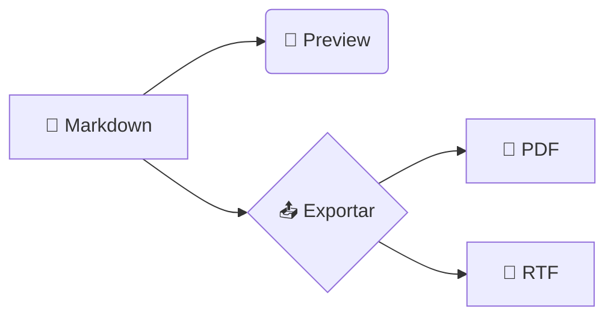

# Ícones e emojis 🎨

Exemplo para conferir se o preview, o PDF e o RTF mostram os mesmos símbolos. Cada seção
mistura emojis e ícones com um tipo de formatação.

## Texto corrido ✍️

Um parágrafo simples com emojis no meio da frase 😀, no fim de uma linha que quebra perto da
margem direita para ver se o emoji vai junto com a palavra 🚀, e emojis colados em pontuação:
pronto!✅ (ok👍) «aspas🙂».

Em **negrito 💪**, em _itálico 🌙_, em **_negrito e itálico ⭐_**, ~~riscado ❌~~,
em `código 🐛` e num [link 🔗](https://example.com).

## Tipos de emoji 🧪

| Tipo                       | Exemplos                 | O que observar                          |
| -------------------------- | ------------------------ | --------------------------------------- |
| Simples                    | 😀 🎉 🚀 🐍 🍕 📦         | um caractere cada                       |
| Com seletor de variação    | ❤️ ⚠️ ☀️ ✔️ ✏️ ☎️          | devem sair coloridos, não em contorno   |
| Sem seletor (texto)        | ❤ ⚠ ☀ ✔ ✏ ☎              | podem sair como símbolo de texto        |
| Tom de pele                | 👍🏻 👍🏽 👍🏿 👋🏼             | mão e tom juntos, não dois desenhos     |
| Sequência com ZWJ          | 👨‍👩‍👧 👩‍💻 🏳️‍🌈 🧑‍🚀          | um desenho só, não pessoas separadas    |
| Bandeiras                  | 🇧🇷 🇵🇹 🇺🇸 🇯🇵 🇪🇺           | bandeira, não duas letras               |
| Teclas                     | 1️⃣ 2️⃣ 3️⃣ #️⃣ *️⃣            | número dentro da tecla                  |
| Fora do plano básico       | 🫠 🪐 🧬 🦀 🥑             | emojis mais novos                       |

## Ícones e símbolos ⚙️

- Marcas: ✓ ✗ ✔ ✘ ☐ ☑ ☒ • ◦ ▪ ▫
- Setas: → ← ↑ ↓ ↔ ⇒ ⇐ ⇔ ➜ ➤ ↩ ↪
- Estrelas e formas: ★ ☆ ✦ ◆ ◇ ● ○ ■ □ ▲ △ ▼ ▽ ♥ ♦ ♣ ♠
- Diversos: ⚡ ☂ ☕ ♻ ⚙ ⚠ ⛔ ✉ ✂ ☎ ⌛ ⏰ ⌘ ⏎ ⎋
- Matemática: ± × ÷ ≠ ≈ ≤ ≥ ∞ √ ∑ ∏ ∫ ∂ ∆ π µ ° ‰
- Moedas: R$ € £ ¥ ₹ ₿ ¢
- Tipografia: © ® ™ § ¶ † ‡ … – — « » „ “ ” ‘ ’
- Caixas: ┌─┬─┐ │ ├─┼─┤ └─┴─┘ ═ ║ ╔ ╗ ╚ ╝ ░ ▒ ▓ █

## Listas com ícones 📋

- 📁 Pasta do projeto
  - 📄 `README.md`
  - 🖼️ `logo.png`
  - ⚙️ `config.json`
- 🗑️ Lixeira

1. 🥇 Primeiro lugar
2. 🥈 Segundo lugar
3. 🥉 Terceiro lugar

### Tarefas ✅

- [x] ✅ Escrever o exemplo
- [x] 🔍 Conferir no preview
- [ ] 📄 Conferir no PDF
- [ ] 📝 Conferir no RTF

## Status em tabela 📊

| Item        | Situação     | Prioridade | Responsável |
| ----------- | :----------: | :--------: | ----------- |
| Login       | ✅ Pronto    | 🔴 Alta    | 👩‍💻 Ana     |
| Relatórios  | 🚧 Em obra   | 🟡 Média   | 👨‍💻 Bruno   |
| Exportação  | ⏳ Pendente  | 🟢 Baixa   | 🤖 Robô     |
| Integração  | ❌ Bloqueado | 🔴 Alta    | —           |

## Citações e avisos 💬

> 💡 **Dica:** um emoji no começo da citação marca o tipo de aviso.

> ⚠️ **Atenção:** este aviso usa um emoji com seletor de variação.
>
> 🛑 **Pare:** segunda linha da mesma citação.

> ℹ️ Citação com ícone de informação
>
> > 🔁 e uma citação dentro dela.

## Títulos com emojis

### 🚀 Emoji no começo

### Emoji no fim 🏁

#### Vários 🔥🔥🔥 no meio

## Código 💻

Emojis dentro de bloco de código devem manter a largura do monoespaçado:

```ts
// 🚀 inicia o servidor
const status = ok ? '✅ pronto' : '❌ falhou';
console.log(`${status} → porta ${port} 🔌`);
```

```text
┌──────────┬─────────┐
│ Serviço  │ Estado  │
├──────────┼─────────┤
│ api      │ ✓ ativo │
│ banco    │ ✗ parado│
└──────────┴─────────┘
```

## Matemática e diagrama 🧮

Fórmula inline com símbolos: $\alpha + \beta \geq \pi$ e texto com ∑ fora da fórmula.



## Nota de rodapé 🦶

Texto com nota que tem emoji.[^1]

[^1]: Nota de rodapé com emoji 📌 e símbolo ✓.

---

Fim 👋
