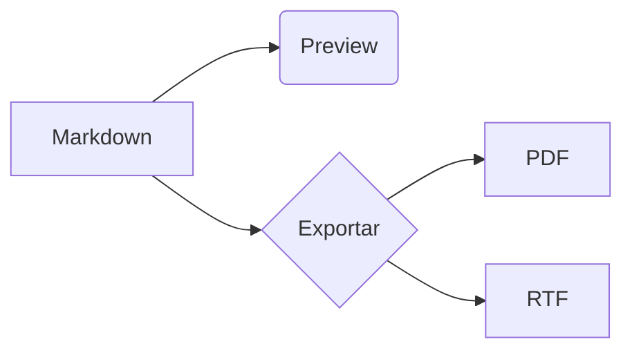

# Kitchen sink

Paragraph with **bold**, _italic_, ~~strike~~, `inline code` and a [link](https://example.com).
Autolink: https://code.visualstudio.com. Link to a [section](#tabelas) and to [another file](other.md#intro).


## Listas

- Item
  - Nested item
- [ ] Pending task
- [x] Done task

1. First
2. Second

> Blockquote with **emphasis**.
>
> Second line with `code` e acentuação: ção, ü, 日本, emoji 🎉.

## Tabelas

| Coluna | Alinhada | Número |
| ------ | :------: | -----: |
| a      |    b     |      1 |
| c      |    d     |     22 |

## Código

```ts
interface User {
  name: string;
}
const greet = (u: User): string => `Olá, ${u.name}`;
```

```python
def soma(a, b):
    return a + b  # comentário
```

```
sem linguagem <b>escapado</b>
```

## Matemática

Inline $E = mc^2$ e bloco:

$$
\int_0^1 x^2 \, dx = \frac{1}{3}
$$

## Diagrama



## Notas

Texto com nota de rodapé.[^1]

[^1]: Esta é a nota.

---

Fim.
